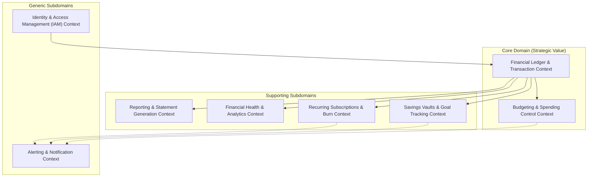
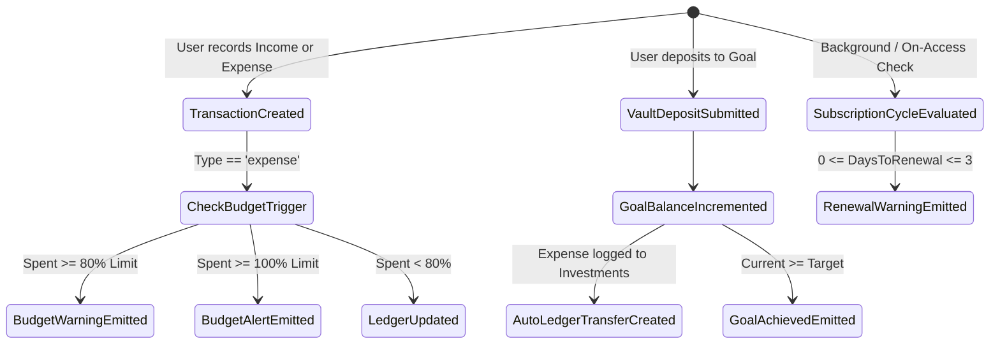

# FinTrack — Ubiquitous Language Specification
**Domain-Driven Design (DDD) Semantic Dictionary & Domain Model**  
*Project:* FinTrack — Personal Financial Management (PFM) Platform   
*Version:* 1.0.0  

---

## 1. Executive Summary & Purpose

In Domain-Driven Design (DDD), the **Ubiquitous Language** is a single, unambiguous, rigorous conceptual vocabulary shared mutually by domain experts, software engineers, and stakeholders. It eliminates terminological ambiguity between business logic, database schemas, API contracts, and user interface elements.

Within the **FinTrack** domain, this document establishes:
- Standard definitions for all business and financial domain concepts.
- The boundary lines between **Bounded Contexts**.
- Identification of **Entities**, **Value Objects**, **Aggregates**, **Domain Events**, and **Domain Services**.
- Invariants, calculation rules, and terms explicitly forbidden to prevent conceptual drift.

---

## 2. Strategic Design & Bounded Contexts

The FinTrack personal finance ecosystem is partitioned into eight distinct Bounded Contexts categorized by strategic relevance:

---

## 3. Domain Terminology by Bounded Context

---

### Context 1: Identity & Access Management (IAM)

| Term | Domain Role | Formal Definition | Invariants & Business Rules | Avoid Using |
|---|---|---|---|---|
| **User Account** | Aggregate Root / Entity | The legal persona registered on FinTrack who owns financial records. | Must have a verified, unique email address. Immutable ownership boundary (no cross-user ledger leakage). | "Customer", "Profile", "Client" |
| **Authentication Provider** | Value Object | The authority validating credentials: `local` (email + bcrypt hash) or `google` (OIDC ID Token). | If provider is `google`, password is NULL and managed externally by Google Identity Services. | "Login mode", "Auth type" |
| **Access Token** | Value Object | A cryptographically signed JSON Web Token (JWT, HS256) granting scoped API authorization. | Expires in exactly 24 hours (1440 minutes). Must be sent via `Authorization: Bearer` header. | "Session key", "Cookie" |
| **Password Reset Token** | Value Object | A short-lived cryptographic single-use token tied to a user's verified email. | Expires in 15 minutes. Invalidation on consumption or expiry. | "Temporary password", "Reset pin" |
| **Credential** | Value Object | Secret authentication token (passwords hashed via 12-round salt bcrypt). | Plaintext passwords must never be persisted, logged, or returned in API responses. | "Passcode" |

---

### Context 2: Financial Ledger & Transactions (Core Domain)

| Term | Domain Role | Formal Definition | Invariants & Business Rules | Avoid Using |
|---|---|---|---|---|
| **Transaction** | Entity / Aggregate Root | An immutable historical ledger entry recording a monetary movement on a specific date. | `amount > 0.00`. Must belong to exactly one User. Contains `date`, `type`, and `category`. | "Payment", "Record", "Movement", "Entry" |
| **Transaction Type** | Value Object | The directional polarity of a transaction: strictly `income` (credit) or `expense` (debit). | Binary enumeration. No zero or negative amount allowed. | "Transaction Direction", "Flow" |
| **Inflow (Income)** | Value Object / Concept | Value credited to the user's ledger (e.g., salary, investment dividend, gift). | Increases Net Balance. Represented visually as positive (`+₹`). | "Money in", "Deposit" (unless for a Goal) |
| **Outflow (Expense)** | Value Object / Concept | Value debited from the user's ledger (e.g., rent, groceries, utility bills). | Decreases Net Balance. Recorded against a monthly budget limit. Represented visually as negative (`-₹`). | "Money out", "Spend" |
| **Payment Method** | Value Object | The financial instrument through which settlement occurred. | Canonical set: `UPI (Google Pay / PhonePe / Paytm)`, `Credit Card`, `Debit Card`, `Net Banking`, `Cash`, `Brokerage`. | "Wallet", "Card type", "Account" |
| **Category** | Entity | A taxonomic classification organizing transactions into semantic spend groups. | Either **System Category** (global, immutable defaults) or **Custom Category** (user-defined with unique name per user). | "Tag", "Label", "Folder" |
| **Merchant / Title** | Value Object | The textual description identifying the payee or source of funds. | Maximum 255 characters. Cannot be blank. | "Note", "Detail" |

---

### Context 3: Budgeting & Spending Control (Core Domain)

| Term | Domain Role | Formal Definition | Invariants & Business Rules | Avoid Using |
|---|---|---|---|---|
| **Master Budget Ceiling** | Entity / Value Object | The absolute maximum expenditure cap set by the user for an entire calendar month. | Represented in database as `category_name = NULL`. Amount must be positive. Defaults to ₹50,000. | "Monthly limit", "Max spend" |
| **Category Budget** | Entity | A departmental ceiling bounding expenses within a single category for a calendar month. | Unique per `(user_id, category_name, month_year)`. `amount_limit > 0`. | "Sub-budget", "Cap" |
| **Billing Period (Month-Year)** | Value Object | The calendar cycle `YYYY-MM` against which expenses are accumulated. | Strictly follows Gregorian calendar months (`2026-10`, `2026-11`). | "Cycle", "Timeframe" |
| **Budget Utilization Ratio** | Domain Calculation | The percentage of allocated budget consumed by real expenses: `(Spent / Limit) * 100`. | - `< 80%`: Safe (Green / Pastel Mint) - `80% - 99.9%`: **Near Ceiling** (Yellow / Pastel Amber) - `≥ 100%`: **Over Budget** (Red / Rose Alert) | "Spend percent", "Budget progress" |
| **Remaining Buffer** | Domain Calculation | Remaining unspent liquidity before breaching the limit: `max(0, Limit - Spent)`. | Non-negative in remaining representation. | "Leftover money", "Free balance" |

---

### Context 4: Savings Vaults & Goal Tracking

| Term | Domain Role | Formal Definition | Invariants & Business Rules | Avoid Using |
|---|---|---|---|---|
| **Savings Goal (Vault)** | Entity / Aggregate Root | A target-based asset accumulation objective with a monetary ceiling and target deadline. | `target > 0.00`, `current >= 0.00`. Progress cannot exceed 100% in UI meter. | "Piggy bank", "Locker", "Jar" |
| **Target Amount** | Value Object | The terminal monetary sum required to consider the goal 100% fulfilled. | Fixed positive numerical value in INR (₹). | "Goal total", "Aim" |
| **Vault Deposit** | Domain Service / Event | An incremental capital contribution allocated to a specific savings goal. | 1. Increments `current` balance of the goal. 2. Automatically records a linked expense transaction in the primary ledger under `Investments & Dividends`. | "Transfer in", "Add money" |
| **Funded Percentage** | Domain Calculation | `(Current / Target) * 100`, bounded between 0% and 100%. | When ratio reaches 100%, triggers `GoalAchievedNotification`. | "Completion rate" |
| **Target Deadline** | Value Object | The target temporal horizon (e.g., `Dec 2026`, `Diwali 2027`, `Ongoing`). | Informational string guiding savings urgency. | "Due date", "Expiry" |

---

### Context 5: Recurring Subscriptions & Committed Burn

| Term | Domain Role | Formal Definition | Invariants & Business Rules | Avoid Using |
|---|---|---|---|---|
| **Subscription** | Entity / Aggregate Root | An automated, recurring financial commitment for services (OTT, SaaS, Gym, Utilities). | Has an invariant renewal frequency, a specific `next_billing_date`, and a lifecycle state. | "Recurring bill", "Standing order" |
| **Billing Cycle** | Value Object | The periodic frequency of fee assessment. | Canonical values: `monthly`, `annual`, `weekly`. | "Frequency", "Interval" |
| **Subscription Status** | Value Object | The operational state of the subscription contract. | Strictly: `active`, `paused`, or `cancelled`. Only `active` subscriptions contribute to Monthly Recurring Burn. | "State", "Condition" |
| **Monthly Recurring Burn** | Domain Calculation | Normalized monthly committed outflow from all active recurring commitments: `Monthly + (Annual / 12) + (Weekly * 4.33)`. | Expressed in INR (₹). Represents non-discretionary baseline spending. | "Fixed cost", "Auto-debit total" |
| **Renewal Horizon** | Value Object / Rule | Proximity to the renewal date. | If `0 <= (next_billing_date - today) <= 3 days`, status is **Upcoming Renewal** and triggers proactive notification. | "Due notice" |

---

### Context 6: Financial Health & Analytics

| Term | Domain Role | Formal Definition | Invariants & Business Rules | Avoid Using |
|---|---|---|---|---|
| **Total Inflow** | Domain Calculation | Sum of all `income` transactions across a selected temporal timeframe. | `Σ(tx.amount for tx where tx.type == 'income')`. | "Gross receipts" |
| **Total Outflow** | Domain Calculation | Sum of all `expense` transactions across a selected temporal timeframe. | `Σ(tx.amount for tx where tx.type == 'expense')`. | "Total burn" |
| **Net Surplus / Deficit** | Domain Calculation | Mathematical difference between Inflow and Outflow: `Total Inflow - Total Outflow`. | Positive indicates **Surplus** (savings generated); negative indicates **Deficit** (capital erosion). | "Profit/Loss", "Margin" |
| **Savings Rate** | Domain Calculation | Proportion of earned income retained: `max(0, (Surplus / Inflow) * 100)`. | Expressed as an integer percentage (0% to 100%). If Inflow is zero, Savings Rate is 0%. | "Retained earnings %" |
| **Daily Spending Intensity** | Domain Calculation | Aggregation of expenditure distributed across days of the week (`Sun` through `Sat`). | Normalizes spending velocity to detect weekend vs. weekday spending spikes. | "Day chart" |
| **Top Expense Outlets** | Domain Calculation | Ranking of merchants/titles by total aggregate expenditure within a period. | Top 5 distinct titles sorted descending by monetary volume. | "Top shops", "Big spenders" |

---

### Context 7: Notifications & Alerting

| Term | Domain Role | Formal Definition | Invariants & Business Rules | Avoid Using |
|---|---|---|---|---|
| **Notification** | Entity | A durable, user-facing notice generated in response to an automated system domain event. | Immutable content once emitted. Tracks `is_read` boolean flag. | "Message", "Email" (unless Brevo SMTP) |
| **Notification Type** | Value Object | Severity indicator determining visual representation. | Strictly: `info` (blue), `success` (green), `warning` (amber), `alert` (red/rose). | "Priority", "Level" |
| **Deduplication Window** | Domain Rule | Prevention of redundant alert spamming. | Identical notification titles for a user are deduplicated within a 24-to-72-hour window. | "Spam filter" |
| **Unread Count** | Value Object / Metric | Total count of notifications where `is_read == false`. | Displayed on the navigation bell badge. Decrements on item read or zeroed on "Mark All as Read". | "New badges" |

---

### Context 8: Reporting & Financial Statements

| Term | Domain Role | Formal Definition | Invariants & Business Rules | Avoid Using |
|---|---|---|---|---|
| **Financial Statement** | Value Object / Aggregate | A formal, auditable compilation of ledger activity for an immutable date window (`startDate` to `endDate`). | Contains Statement Reference ID (`FT-YYYY-XXXXXX`), opening/closing metrics, category summaries, and chronological ledger lines. | "Invoice", "Bill", "Slip" |
| **Statement Period** | Value Object | Defined temporal bounds: `Current Month`, `Last Month`, `Last 3 Months`, `Q3 2026`, `Year 2026`, or `Custom Range`. | Bounded by ISO 8601 date strings (`YYYY-MM-DD`). | "Filter window" |
| **Printable Document** | Presentation Service | A high-fidelity CSS print-media layout formatted for A4 physical print and PDF export. | Strips interactive navigation elements, applies monochromatic dark/light contrast, and embeds verification stamps. | "Webpage snapshot" |
| **Account Backup (JSON)** | Data Interchange Object | A machine-readable JSON archive containing complete user state (preferences, transactions, vaults, subscriptions). | Versioned, idempotent export for data sovereignty and disaster recovery. | "Raw dump" |

---

## 4. Domain Events & State Machine

### Event Specifications

1. **`TransactionRecordedEvent`**
   - **Trigger:** A new entry is committed to the ledger.
   - **Payload:** `{ transaction_id, user_id, amount, type, category, date }`
   - **Side Effect:** Re-evaluates monthly budget utilization; updates aggregate net balance.

2. **`BudgetBreachedEvent`**
   - **Trigger:** An expense transaction causes `Σ(category_expenses) >= amount_limit`.
   - **Severity:** `alert` (100% breach) or `warning` (80% ceiling approach).
   - **Side Effect:** Spawns an unread `Notification` in Context 7.

3. **`GoalAchievedEvent`**
   - **Trigger:** A deposit causes `goal.current >= goal.target`.
   - **Payload:** `{ goal_id, user_id, name, final_amount }`
   - **Side Effect:** Emits celebratory `success` notification; marks goal as 100% funded.

4. **`SubscriptionRenewalApproachingEvent`**
   - **Trigger:** A subscription's `next_billing_date` falls within 72 hours of current system date.
   - **Side Effect:** Generates a `warning` notification with payment method and amount.

---

## 5. Currency & Financial Invariants

1. **Monetary Unit of Account:**
   - The primary currency of the domain is the **Indian Rupee (INR, ₹)**.
   - Standard display format follows the Indian numbering system: **₹Lakhs & Crores** (e.g., `₹1,50,000.00`, `₹15,00,000.00`).
2. **Precision & Rounding:**
   - Database storage: Floating-point / Decimal stored to 2 decimal places (`round(amount, 2)`).
   - Ledger amounts must be strictly positive real numbers ($> 0.00$). Zero or negative values are rejected at the schema boundary.
3. **Data Isolation (Tenant Invariant):**
   - Every read, update, or delete query must enforce `user_id == current_user.id`. No cross-user leakage is mathematically possible under standard operating procedures.

---

## 6. Proscribed & Anti-Pattern Terminology

To prevent cognitive dissonance, the following replacements are strictly mandated across code, documentation, and interface copy:

| ❌ Forbidden Term | ✅ Canonical Ubiquitous Term | Rationale |
|---|---|---|
| *Debit / Credit* | **Expense / Income** | Avoids banking accounting polarity confusion (bank credit vs user debit). |
| *Money in / Money out* | **Inflow / Outflow** | Maintains professional financial rigor. |
| *Tag / Label* | **Category** | Categories have strict domain behavior (budget caps, analytics segmentation). |
| *Piggy bank / Locker* | **Savings Goal (Vault)** | Avoids colloquial slang in financial auditing. |
| *Standing order* | **Recurring Subscription** | Accurately represents modern digital subscriptions (OTT, cloud, memberships). |
| *Total profit* | **Net Surplus** | Personal finance tracks surplus capital, not commercial enterprise profit. |
| *Webpage print* | **Financial Statement / PDF** | Recognizes the formal auditing nature of the document. |

---
